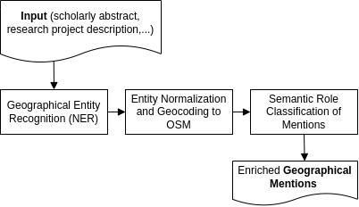

# geordie 📌🅾️💀

> _Geo or die_ / _Impiccheranno **Geordie** con una corda d'oro_ / _**G**eographical **E**ntity **O**bject **R**ecognition, **D**etection, **I**dentification and **E**xtraction_

A Python library for extracting geographic entities from text, linking them to geographic databases, and classifying the semantic role of each mention.

## Pipeline overview



## Features

- **NER** — Fine-tuned multilingual DistilBERT model for geographic entity recognition (EN, ES, IT, FR, DE, CA).
- **Normalisation** — Demonyms, adjectives, and country codes are resolved to canonical country names across six languages. Regex pattern compiled once at import time for efficiency.
- **Entity linking** — Two interchangeable backends:
  - **Nominatim** (default) — OpenStreetMap geocoding API with persistent SQLite cache. Exposes `osm_class`, `osm_type`, and `address_type` as distinct fields.
  - **GeoNames** (local) — Offline linking against an auto-downloaded GeoNames dump. Two-stage matching: exact lookup followed by trigram retrieval + difflib reranking.
- **Semantic role classification** — Fine-tuned model to classify how each geographic entity is mentioned in context.
- **Persistent caching** — SQLite-backed cache stored in `~/.cache/geordie/` (same convention as HuggingFace Hub). Supports TTL, LRU eviction, `stats()`, and context manager usage.
- **Lazy imports** — `torch`, `nltk`, and `geopy` are only imported when actually used, so lightweight submodules load without heavy dependencies.

---

## Installation

```bash
# From source
git clone https://github.com/sirisacademic/geordie.git
cd geordie
pip install .

# With uv (recommended)
uv pip install .

# With dev tools (pytest, ruff, pytest-cov)
pip install ".[dev]"
```

---

## Quick start

### Basic usage (Nominatim backend)

```python
import geordie

# Create the pipeline (auto-detects CPU/CUDA)
g = geordie.Geordie()

# Process a text
results = g.process_text(
    "This study analyses coastal vulnerability in the Ebro Delta "
    "and applies the model to the beach of s'Abanell."
)

for item in results:
    print(f"Entity: {item['entity']}  ->  {item['entity_normalised']}")
    print(f"  Geo:  {item['geo'].get('name', '-')} ({item['geo'].get('country', '-')})")
    print(f"  Role: {item['role_label']}")
```

### Using GeoNames (offline, faster, auto-downloaded)

The GeoNames dump is downloaded automatically to `~/.cache/geordie/geonames/` on first use.

```python
import geordie

# Auto-downloads cities15000.txt on first run
g = geordie.Geordie(linker_backend="geonames")

# Choose a different dump
g = geordie.Geordie(linker_backend="geonames", dump="cities5000")

# Point to an existing local file
g = geordie.Geordie(
    linker_backend="geonames",
    geonames_path="/data/allCountries.txt",
)

results = g.process_text("The conference was held in Barcelona and Madrid.")
```

Available dumps:

| Dump | Entries | Use case |
|---|---|---|
| `cities500` | ~200k | High recall, still manageable |
| `cities5000` | ~55k | Good balance for research texts |
| `cities15000` | ~25k | Default — fast, covers major cities |
| `allCountries` | ~12M | Full offline coverage |

### Custom linker with cache settings

```python
from geordie import Geordie
from geordie.linkers.nominatim import NominatimLinker

linker = NominatimLinker(
    cache_ttl=86400 * 30,       # 30-day TTL
    sleep_between_calls=1.5,    # respect rate limits
    language="es",              # results in Spanish
)

g = Geordie(linker=linker)
```

### Inspect cache

```python
from geordie.linkers.base import SQLiteCache, get_cache_dir

print(get_cache_dir())   # ~/.cache/geordie

with SQLiteCache() as cache:
    print(cache.stats())
    # {
    #   "db_path": "~/.cache/geordie/geordie_cache.db",
    #   "size": 1234,
    #   "maxsize": 50000,
    #   "ttl": None,
    #   ...
    # }
```

### Download GeoNames manually

```python
from geordie.utils.download import download_geonames_dump

# Downloads to ~/.cache/geordie/geonames/cities15000.txt
path = download_geonames_dump("cities15000")
print(path)
```

### CLI

```bash
echo "Research in Delhi and Barcelona" | geordie --backend nominatim
geordie "The Bauhaus in Weimar and Dessau" --device cpu --no-cache
geordie "Study in Paris" --backend geonames
```

---

## Output format

Each item in the result list contains:

| Key | Type | Description |
|---|---|---|
| `entity` | `str` | Original entity string from NER |
| `entity_normalised` | `str` | Normalised form (demonym/adjective resolved) |
| `context` | `str` | Sentence with `[START_ENT] … [END_ENT]` markers |
| `geo` | `dict` | Geographic linking result (empty dict on miss) |
| `role` | `list` | Raw classifier output |
| `role_label` | `str` | Human-readable semantic role |

### Nominatim geo fields

| Field | Description |
|---|---|
| `name` | Place name |
| `lat`, `lon` | Coordinates as `float` |
| `osm_class` | OSM class (e.g. `"boundary"`, `"place"`) |
| `osm_type` | OSM type (e.g. `"administrative"`, `"city"`) |
| `address_type` | Most specific address component (`"city"`, `"town"`, …) |
| `country`, `country_code` | Country name and ISO code |
| `wikidata`, `wikipedia` | Linked data identifiers |
| `source` | `"nominatim"` |

### GeoNames geo fields

| Field | Description |
|---|---|
| `name` | Place name |
| `lat`, `lon` | Coordinates as `float` |
| `country_code` | ISO 3166-1 alpha-2 |
| `feature_class` | GeoNames feature class (`P`, `A`, …) |
| `feature_code` | GeoNames feature code |
| `admin1`, `admin2` | Administrative divisions |
| `population` | Population count |
| `match_type` | `"exact"` or `"fuzzy"` |
| `match_score` | Composite disambiguation score (0–1) |
| `source` | `"geonames_local"` |

---

## Semantic role classification

| Role | Description |
|---|---|
| **Object of Study** | The geographic entity is the primary focus of research — directly or as the location of a case study or pilot. |
| **Location of Research** | Where the research is conducted: institutions, fieldwork sites, survey locations, conference venues, hospitals, excavation sites. |
| **Policy or Regulation Reference** | The entity appears in the title or description of a policy/regulation, or provides its geographic scope. |
| **Target Audience / Beneficiary** | The geographic entity identifies who benefits from the research or receives its impact. |
| **Contextual / Other** | Background context, comparison, historical/cultural framing, or incidental mention. |

---

## Models

| Component | Model | HuggingFace |
|---|---|---|
| NER | Fine-tuned DistilBERT (token classification) | [`SIRIS-Lab/geordie-ner`](https://huggingface.co/SIRIS-Lab/geordie-ner) |
| Role classification | Fine-tuned DistilBERT (sequence classification) | [`SIRIS-Lab/geordie-role`](https://huggingface.co/SIRIS-Lab/geordie-role) |

Models are downloaded automatically from HuggingFace Hub on first use and cached in `~/.cache/huggingface/hub/`.

### NER training data

| Language | Dataset | Categories |
|---|---|---|
| Catalan | CEIL | GPE, Location, Building |
| Multilingual (EN, IT, ES, DE) | europarl-ner | LOC |
| English | FewNERD | Location, Building |
| Multilingual | MultiNERD | LOC |

### NER evaluation

| Metric | Precision | Recall | F1 | Support |
|---|---|---|---|---|
| GEO entity | 0.902 | 0.907 | 0.905 | 24,526 |

### Entity normalisation

Demonyms, adjectives, and country codes are normalised into canonical country names using a multilingual dictionary (EN, ES, IT, FR, CA, DE). Evaluated on 170 Catalan mentions with **accuracy = 0.82** on Nominatim resolution.

---

## Entity linking backends

### Nominatim (default)

Uses the [OpenStreetMap Nominatim](https://nominatim.org/) geocoding service.
Results are cached in `~/.cache/geordie/nominatim.db`.

Key parameters:

| Parameter | Default | Description |
|---|---|---|
| `cache_path` | `~/.cache/geordie/nominatim.db` | SQLite cache path |
| `cache_ttl` | `None` | TTL in seconds (`None` = never expire) |
| `sleep_between_calls` | `1.1` | Delay between API calls |
| `language` | `"en"` | ISO 639-1 language code for results |
| `importance_threshold` | `0.0` | Discard results below this score |

### GeoNames (local/offline)

Uses a local [GeoNames](https://www.geonames.org/) TSV dump.
Matching uses a two-stage cascade:

1. **Exact match** — normalised name lookup in an in-memory index (including all alternate names)
2. **Fuzzy match** — trigram retrieval followed by difflib reranking with a composite score (60% name similarity + 30% log population + 10% feature class priority)

Results are cached in `~/.cache/geordie/geonames.db`.

Key parameters:

| Parameter | Default | Description |
|---|---|---|
| `geonames_path` | `None` | Path to `.txt` file. Auto-downloads if `None` |
| `dump` | `"cities15000"` | Which dump to auto-download |
| `force_download` | `False` | Re-download even if cached |
| `cache_path` | `~/.cache/geordie/geonames.db` | SQLite cache path |
| `min_population` | `0` | Skip entries below this population |
| `feature_classes` | `{"P", "A"}` | GeoNames feature classes to index |
| `use_fuzzy` | `True` | Enable trigram + difflib fallback |
| `fuzzy_threshold` | `0.65` | Minimum similarity to accept a fuzzy match |
| `max_fuzzy_candidates` | `10` | Trigram candidates to rerank |

---

## Cache system

All caches follow the same convention as HuggingFace Hub and NLTK:

```
~/.cache/geordie/
├── nominatim.db          ← Nominatim SQLite cache
├── geonames.db           ← GeoNames SQLite cache
└── geonames/
    └── cities15000.txt   ← auto-downloaded GeoNames dump
```

Override the cache location via environment variables:

```bash
export GEORDIE_CACHE=/path/to/custom/cache      # full override
export XDG_CACHE_HOME=/path/to/xdg             # XDG standard
```

---

## Project structure

```
geordie/
  pyproject.toml
  README.md
  TESTING.md
  geordie/
    __init__.py               # Main Geordie pipeline class (lazy imports)
    ner.py                    # NER component
    normaliser.py             # Demonym/adjective normalisation
    role_classification.py    # Semantic role classifier
    cli.py                    # Command-line interface
    linkers/
      __init__.py             # Lazy loader for linker backends
      base.py                 # SQLiteCache + BaseLinker + cache dir helpers
      nominatim.py            # Nominatim (OSM) linker
      geonames.py             # GeoNames local linker with fuzzy matching
    utils/
      __init__.py
      download.py             # Auto-download GeoNames dumps
    resources/
      demonyms_and_adjectives.py
      country_codes.py
      examples/
        example.txt
  tests/
    test_cache.py
    test_normaliser.py
    test_linkers.py
    test_geonames.py
    test_download.py
    test_nominatim_live.py
    test_pipeline.py
```

---

## Testing

See [TESTING.md](TESTING.md) for the full testing guide. Quick reference:

```bash
# Fast tests — no network, no models
python -m pytest tests/ -v --ignore=tests/test_nominatim_live.py --ignore=tests/test_pipeline.py

# Include live Nominatim (network)
python -m pytest tests/ -v --ignore=tests/test_pipeline.py

# Full suite including HuggingFace models
python -m pytest tests/ -v

# With coverage
python -m pytest tests/ -v --cov=geordie --cov-report=term-missing
```

> **Note:** Always use `python -m pytest` rather than bare `pytest` to ensure the venv Python is used.

---

## Requirements

**Core:** `transformers`, `torch`, `nltk`, `geopy`, `requests`

**Optional:** `pandas` (not required — GeoNames support uses only stdlib `csv`)

**Dev:** `pytest`, `pytest-cov`, `ruff`

---

## TODO

- [ ] Define world region based on coordinates
- [ ] Add `advanced=True` output mode with full raw fields
- [ ] Batch processing optimisation for `process_corpus`
- [ ] Add country name resolution for GeoNames (`country_code` → full name)

---

## License

MIT

---

## Citation

If you use geordie in your research, please cite:

```bibtex
@software{geordie,
  title  = {geordie: Geographical Entity Object Recognition, Detection, Identification and Extraction},
  author = {SIRIS Academic},
  url    = {https://github.com/sirisacademic/geordie},
  year   = {2025}
}
```
```
@inproceedings{grimau2025textual,
  title     = {Textual Footprints of Science: Analyzing Geographical Mentions in Research Outputs},
  author    = {Grimau, Berta and Duran-Silva, Nicolau and Fern{\'a}ndez-Sirera, Tatiana and Fuster, Enric},
  booktitle = {Metascience 2025},
  year      = {2025},
  month     = {July},
  address   = {University College London, London, UK},
  url       = {https://nomadit.co.uk/conference/metascience2025/paper/91432},
}
```


